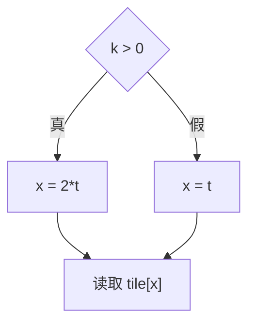

# 控制流分析和数据流分析

控制流分析关心“程序可能沿哪些路径执行”；数据流分析关心“沿这些路径，哪些信息会传到哪里、怎样变化”。两者经常配合使用

例子：
```
int x;
if (k > 0)
    x = 2 * t;
else
    x = t;

out[t] = tile[x];
```

控制流如下：


控制流分析（无非是正常路线、if类分支、循环类）：
- 分支出口通向哪
- 不同路径在哪汇合
- 到达某个BB之前，可能会经过哪些
- 如果存在循环，哪些会返回循环体

数据流分析：
- 真分支传的是
- 假分支传的是
- 汇合后怎么保存可能性

然后根据是否保留路径关系

主要区别：
| 方面 | 控制流结构分析 | 数据流分析 |
|---|---|---|
| 主要处理对象 | 基本块、区域、跳转边、循环 | 每个值或程序位置上的分析状态 |
| 典型数据 | 前驱、后继、支配关系、循环结构 | 常量、范围、表达式、可能指向的对象 |
| 主要操作 | 遍历图，计算结构关系 | 根据操作更新状态，在合流处合并 |
| 对循环的处理 | 找到循环及回边 | 必要时反复传播状态直到稳定 |
| 需要自定义的内容 | 分析目标涉及的控制结构规则 | 状态表示、转移规则、合并规则和收敛策略 |

# 数据流分析

- 格与单调框架